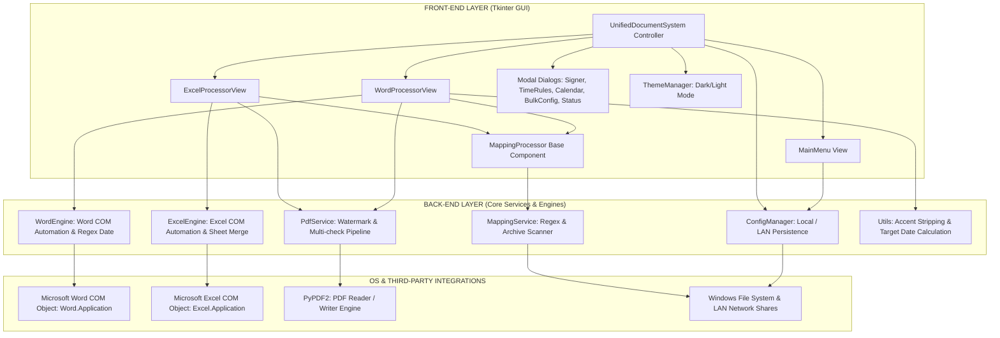
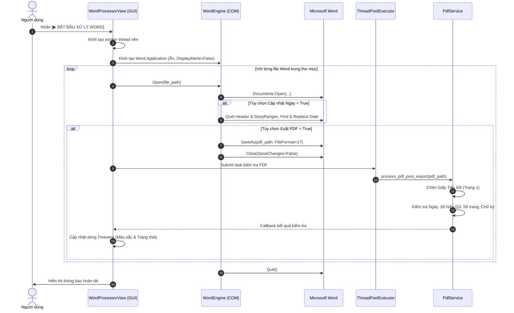
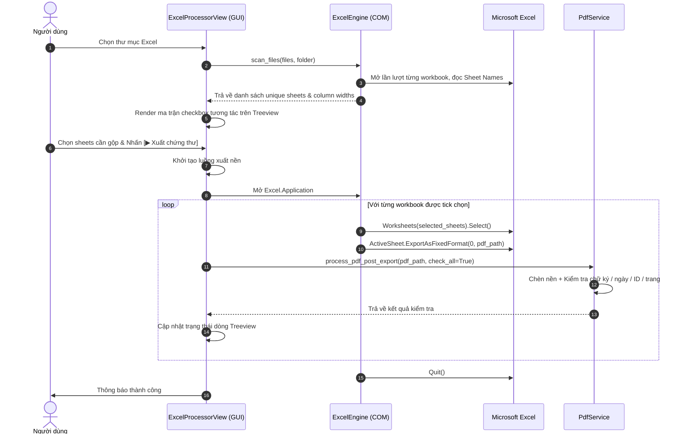
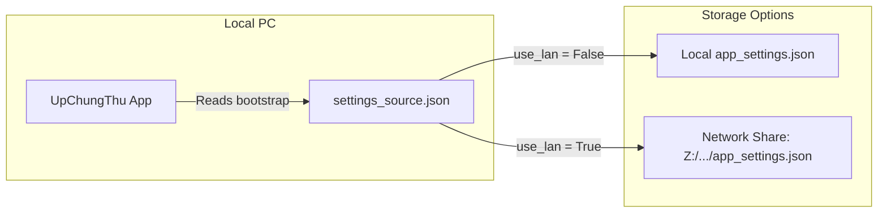

# KIẾN TRÚC PHẦN MỀM UPCHUNGTHU (ARCHITECTURE DOCUMENTATION)

Tài liệu này mô tả chi tiết kiến trúc kỹ thuật của hệ thống phần mềm **UpChungThu**, nguyên lý phân tách **Front-End / Back-End**, luồng xử lý dữ liệu và cơ chế tự động hóa qua COM.

---

## 1. Nguyên Lý Thiết Kế & Tổng Quan Kiến Trúc

Hệ thống được thiết kế theo mô hình **Layered Architecture (Kiến trúc phân tầng)** với sự phân tách tuyệt đối giữa giao diện người dùng và xử lý nghiệp vụ:

### Các nguyên lý cốt lõi:
1. **Separation of Concerns (SoC)**:
   - **Front-End (`gui/`)**: Chỉ chịu trách nhiệm hiển thị giao diện, thu thập sự kiện từ người dùng (click, input, focus, browse), render danh sách kết quả và chuyển đổi chủ đề (Theme). Không chứa bất kỳ câu lệnh trực tiếp nào liên quan đến `win32com` hay `PyPDF2`.
   - **Back-End (`core/`)**: Chứa toàn bộ logic nghiệp vụ thuần túy (COM Automation, regex date detection, PDF background merging, signer consistency tracking, date calculations, file mapping). Các service nhận đầu vào là file path / tham số và trả về kết quả cấu trúc, hoàn toàn độc lập với GUI.
2. **Non-blocking Concurrency (Bất đồng bộ & Đa luồng)**:
   - Các tác vụ COM nặng và ghép PDF được ủy quyền cho `threading.Thread` hoặc `concurrent.futures.ThreadPoolExecutor`.
   - Giao diện Tkinter không bao giờ bị đơ (Freeze) trong khi Word/Excel đang mở hoặc xuất hàng loạt file.
   - Luồng nền cập nhật trạng thái UI an toàn thông qua `root.after(0, callback)`.
3. **Graceful COM Resource Management**:
   - Mọi tiến trình Word/Excel COM đều được khởi tạo với `pythoncom.CoInitialize()` trong luồng riêng và bắt buộc gọi `Quit()` + `pythoncom.CoUninitialize()` trong khối `finally`.

---

## 2. Ma Trận Trách Nhiệm Của Các Module (Module Responsibility Matrix)

| Module | Tầng | Trách nhiệm chính |
| :--- | :--- | :--- |
| **`core.config_manager`** | Back-End | Đọc, ghi và đồng bộ cấu hình JSON (`app_settings.json`, `settings_source.json`); hỗ trợ chuyển đổi LAN/Local; quản lý thư viện người ký và quy tắc giờ. |
| **`core.pdf_service`** | Back-End | Ghép hình nền giấy tiêu đề lên trang 1; chạy 4 bộ kiểm tra: chữ ký, ngày tháng, số hiệu Q3 và số trang; nhận diện ngôn ngữ V/E. |
| **`core.word_service`** | Back-End | Điều khiển MS Word qua COM; tìm và thay thế ngày trong header, story ranges, shapes và phụ lục theo regex; xuất tài liệu ra PDF. |
| **`core.excel_service`** | Back-End | Điều khiển MS Excel qua COM; quét cấu trúc workbook đọc danh sách sheet; gộp các sheet được chọn và xuất PDF. |
| **`core.mapping_service`** | Back-End | Quét các thư mục gốc lưu trữ hồ sơ; lập chỉ mục thư mục có 6 chữ số; tự động tìm thư mục con `tbkq`. |
| **`core.utils`** | Back-End | Chuẩn hóa chuỗi (bỏ dấu tiếng Việt); tính toán ngày đích theo mốc giờ và bỏ qua cuối tuần (T7, CN). |
| **`gui.theme`** | Front-End | Quản lý bảng màu (Light/Dark Theme), phông chữ hiện đại và ThemeManager. |
| **`gui.app`** | Front-End | Controller ứng dụng chính (`UnifiedDocumentSystem`); quản lý routing trang, chuyển đổi dark mode, đăng ký style TTK. |
| **`gui.components.base_processor`** | Front-End | Frame cơ sở chứa thanh tìm kiếm hồ sơ tự động gợi ý (Autocomplete Listbox) và các nút điều khiển mapping. |
| **`gui.views.main_menu`** | Front-End | Màn hình điều hướng chính; cụm cài đặt nguồn dữ liệu LAN/Local; nút reset cài đặt mặc định. |
| **`gui.views.word_view`** | Front-End | Màn hình phân hệ Word: chọn thư mục, cấu hình cập nhật ngày, hiển thị bảng kết quả kiểm tra thời gian thực. |
| **`gui.views.excel_view`** | Front-End | Màn hình phân hệ Excel: chọn thư mục, ma trận chọn sheet, xuất tính toán/chứng thư. |
| **`gui.dialogs.*`** | Front-End | Các cửa sổ pop-up modal: Thư viện người ký, Cài đặt quy tắc giờ, Lịch chọn ngày, Cấu hình chọn nhanh & gộp sheet, Tiến trình quét. |

---

## 3. Sơ Đồ Luồng Hoạt Động Chi Tiết (Detailed Workflows)

### 3.1. Luồng Xử Lý Phân Hệ Word (Word Processing Pipeline)

### 3.2. Luồng Xử Lý Phân Hệ Excel (Excel Merging & Verification Pipeline)

---

## 4. Đặc Tả Bộ Quy Tắc Kiểm Tra Tính Hợp Lệ (Verification Rules)

### 4.1. Kiểm Tra Chữ Ký (Signer Verification)
- **Tách tên không dấu**: Nhờ hàm `remove_accents()`, hệ thống đối soát cả chuỗi có dấu tiếng Việt (ví dụ: *"Nguyễn Xuân Nam"*) và chuỗi không dấu (ví dụ: *"Nguyen Xuan Nam"*) trên các tài liệu tiếng Anh (`- E`).
- **Kiểm tra đồng nhất mẫu (Consistency Check)**: File đầu tiên thành công trong folder sẽ chốt bộ `(GDV, Boss)` làm mẫu chuẩn. Mọi file sau nếu phát hiện người ký khác mẫu sẽ bị đánh cờ cảnh báo `KHÁC MẪU`.

### 4.2. Kiểm Tra Ngày Tháng (Date Verification)
- Hỗ trợ 3 định dạng:
  - Định dạng chuẩn: `DD/MM/YYYY`
  - Định dạng tiếng Anh: `MMMM DD, YYYY` (ví dụ: `April 21, 2026`)
  - Định dạng tiếng Việt: `ngày DD tháng MM năm YYYY`
- Quy tắc hợp lệ: **Mỗi trang phải chứa ngày và tổng số lần xuất hiện trên toàn file phải bằng đúng tổng số trang**.

### 4.3. Kiểm Tra Số Hiệu Hồ Sơ (Document ID)
- Biểu thức chính quy: `Q3\d{2}[A-D]\d{6}(?:/\d+)?(?:/E)?(?:\.R)?`
- **Cấu trúc số hiệu**:
  - Mã gốc: `Q3\d{2}[A-D]\d{6}` (ví dụ: `Q326D000001`). Luôn có mặt tại phần **body** (thân) trang 1.
  - Phân nhánh kết quả: Hậu tố `/\d+` (ví dụ: `Q326D000001/1`, `Q326D000001/2` cho Tiếng Việt, hoặc `Q326D000001/1/E` cho Tiếng Anh).
  - Bản sửa đổi/phát hành lại: Hậu tố `.R` (ví dụ: `Q326D000001/1.R` hoặc `Q326D000001/1/E.R`) được chấp nhận là hợp lệ (`OK`).
- **Quy tắc bản Tiếng Anh (English version - có hậu tố `- E`, `- EN`, `- ENG`)**:
  - **Header**: Mọi trang trong file ($1 \dots N$) đều phải có số hiệu kết thúc bằng `/E` hoặc `/E.R` ở phần header và phải **đồng nhất hoàn toàn** giữa các trang (ví dụ: `Q326D000001/1/E.R`).
  - **Body trang 1**: Phần thân của trang 1 phải chứa số hiệu gốc không có `/E` (ví dụ: `Q326D000001`).
- **Quy tắc bản Tiếng Việt (Vietnamese version)**:
  - Header mọi trang phải đồng nhất số hiệu và không chứa `/E` (ví dụ: `Q326D000001/1.R` hoặc `Q326D000001`).
  - Không được có trang nào chứa hậu tố `/E`.
- **Kiểm tra đồng nhất**: Mọi header trong cùng 1 file phải có cùng số hiệu hồ sơ. Báo cáo chi tiết từng trang bị thiếu, thừa `/E` hoặc khác mẫu header.

### 4.4. Kiểm Tra Đánh Số Trang (Page Numbering)
- Từ trang 2 trở đi, hệ thống quét chuỗi dạng `i/(total - 1)` (ví dụ file 4 trang thì trang 2 là `1/3`, trang 3 là `2/3`, trang 4 là `3/3`).
- Báo cáo chi tiết các trang bị thiếu hoặc sai quy cách (ví dụ: `Page: 2/3 (Miss: P3)`).

---

## 5. Đồng Bộ Dữ Liệu & Quản Lý Cấu Hình (LAN & Local Persistence)

Hệ thống hỗ trợ 2 chế độ cấu hình:
1. **Local Mode**: Dữ liệu lưu trực tiếp tại file `app_settings.json` trong thư mục cài đặt ứng dụng.
2. **LAN Mode**: Tệp `settings_source.json` trỏ tới đường dẫn mạng chia sẻ (ví dụ: `Z:/KHAC/UpChungThu/app_settings.json`). Khi bật LAN mode, tất cả máy trạm trong cơ quan dùng chung thư viện người ký, thư mục mapping và quy tắc giờ.

---
*Tài liệu được cập nhật tự động theo phiên bản mã nguồn mới nhất.*
